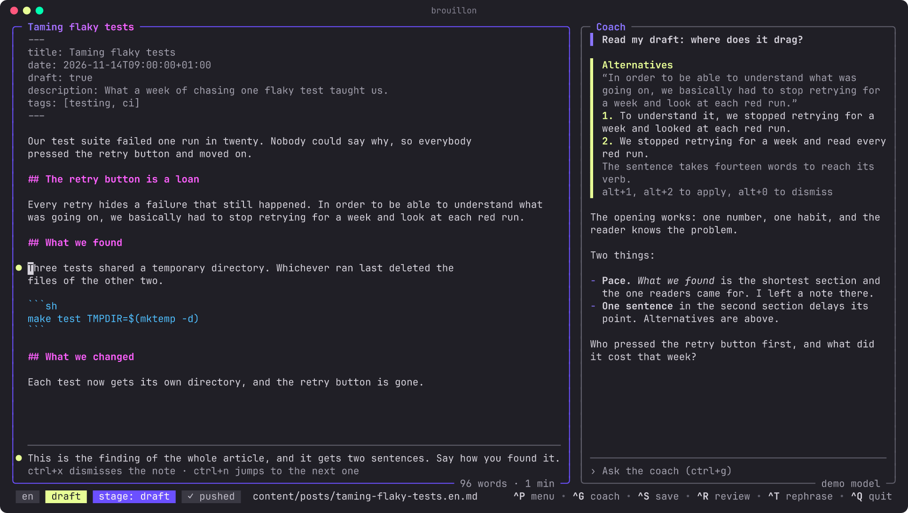
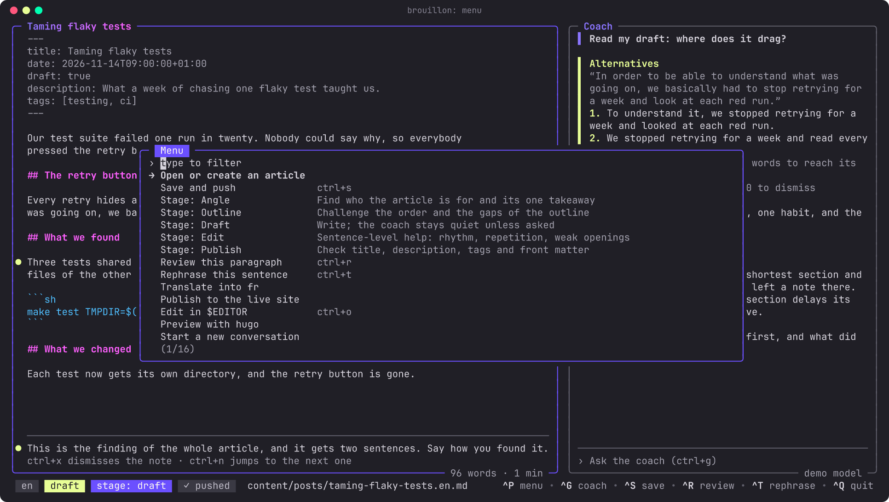

<h1 align="center">
  <picture>
    <source media="(prefers-color-scheme: dark)" srcset="docs/logo-dark.svg">
    
  </picture>
</h1>

A terminal writing desk for a Hugo blog kept in git: a markdown editor on the left, a
writing coach on the right, and git underneath. You write the article; the coach asks
questions, points at weak passages and offers alternative wordings for a sentence you
choose. Publishing is a push to the blog repository.



It was written for [okcomputer.cloud](https://okcomputer.cloud) and works with any blog
that fits [the layout below](#what-the-blog-must-look-like).

Built on the [Pi](https://github.com/earendil-works/pi) libraries: `pi-tui` for the
interface, `pi-agent-core` for the coach, `pi-ai` for the model, including sign-in with a
ChatGPT subscription.

## Install

You need:

- [mise](https://mise.jdx.dev), which installs the right Node version;
- git, with push access to your blog's repository that works without a prompt (an SSH key
  in an agent, or a credential helper);
- optionally [Hugo](https://gohugo.io), for the local preview.

```sh
git clone https://github.com/equelin/brouillon.git
cd brouillon
make setup      # tools and dependencies
make install    # launcher in ~/.local/bin/brouillon
```

### First start

```sh
brouillon
```

The first start asks which blog you write for, then opens the writing desk:

| Question | Suggested answer |
|---|---|
| Git URL of the blog repository | none: this one is required |
| Branch whose pushes publish the site | the repository's default branch |
| Directory of the articles | `content/posts` |
| Languages of the site, the default one first | `en` |
| Name of the blog | the repository's name |
| What the blog is about, in a few words | none: the coach uses it to judge what readers know |

The answers go to `~/.config/brouillon/config.json`, and the blog is cloned into
`~/.local/share/brouillon/<repository name>`. `brouillon setup` asks again, with your
current answers suggested.

### The coach

```sh
brouillon login   # sign in with ChatGPT; paste the redirect URL when on a remote machine
```

The editor and publishing work without it; the coach pane then says it is signed out.

### What the blog must look like

- Articles are markdown files named `<slug>.<lang>.md` in one directory, such as
  `content/posts/my-article.en.md`: Hugo's
  [translation by file name](https://gohugo.io/content-management/multilingual/#translation-by-file-name).
  A blog in one language uses the same naming.
- Front matter is YAML or JSON, with `title`, `date` and `draft`.
- A push to the publish branch deploys the site (GitHub Pages, Netlify or similar).
  brouillon only pushes; it does not build the site.

## Writing

| Key | Action |
|---|---|
| `ctrl+p` | Menu: every command below, plus stages, translation, publishing, preview, sign-in |
| `ctrl+g` | Switch between the article and the coach |
| `tab` / `shift+tab` | Indent to the next multiple of four spaces / remove one level |
| `ctrl+s` | Save and push the draft |
| `ctrl+r` | Ask the coach to review the paragraph under the cursor |
| `ctrl+t` | Ask for alternative phrasings of the sentence under the cursor |
| `alt+1` `alt+2` `alt+3` | Apply an alternative; `alt+0` dismisses them |
| `ctrl+n` / `ctrl+x` | Jump to the next coach note / dismiss the note under the cursor |
| `ctrl+o` | Edit the article in `$EDITOR` |
| `ctrl+z` / `ctrl+y` | Undo / redo |
| `esc` | Stop the coach while it answers |
| `ctrl+q` | Quit |



The article is written to disk two seconds after you stop typing. Mouse clicks place the
cursor and the wheel scrolls.

Dragging selects text and copies it on release. A selection stays inside the pane where it
started, and one made in the article copies the text as written, without the line breaks
of the wrapping. The copy goes through the terminal (OSC 52): inside tmux it needs
`set -g set-clipboard on`.

### Talking to the coach

| Key | Action |
|---|---|
| `enter` | Send the message |
| `alt+enter`, `shift+enter`, or `\` then `enter` | New line in the message |
| `up` / `down` | Recall earlier messages, from the first and last line of the prompt |
| `pageup` / `pagedown`, `shift+up` / `shift+down` | Scroll the conversation |

Messages are kept across sessions in `~/.local/share/brouillon/prompt-history.json`. A
message sent while the coach is still answering stays in the prompt. "Start a new
conversation" in the menu makes the coach forget the current one.

### What the coach can and cannot do

The coach has six tools and no others: read the article, list and read earlier articles
(your voice), attach a note to a passage, offer two or three rephrasings of a passage, and
write a translation. It has no tool that edits the article. A rephrasing must quote a
passage that exists in the article, stay within one paragraph, and not double its length;
it reaches the text only when you press `alt+N`.

Stages (menu) tell the coach what kind of help you want: **Angle** (it interviews you),
**Outline**, **Draft** (it stays quiet), **Edit** (sentence-level), **Publish** (title,
description, tags).

### Translation

*Translate into en* in the menu asks the coach to translate the open article and write
`<slug>.en.md` beside it, with the same date, tags and `translationKey`. This is the one
case where the coach produces full text. Open the translation from the menu to review it.

## How drafts reach the site

- An article is edited on its own branch, `post_<slug>` (letters and underscores; digits
  are spelled out). The branch is created by the first save.
- Every save rewrites that branch's single commit, `Add article <title>` or
  `Update article <title>`, and pushes it with `--force-with-lease`.
- *Publish* sets `draft: false` on every language version, dates a first publication
  today, rebases the commit on the publish branch, fast-forwards that branch, pushes it and
  deletes the draft branch. The push is what deploys the site.
- Commits use the repository's own signing configuration. When the OpenPGP key is locked,
  brouillon says so before committing and offers to unlock it on the terminal.

## Configuration

`~/.config/brouillon/config.json`. The first start writes the first six keys; the others
are optional:

| Key | Default | Meaning |
|---|---|---|
| `repoUrl` | asked | Repository of the blog, cloned when `repoPath` is missing |
| `publishBranch` | asked | Branch whose pushes deploy the site |
| `articlesDir` | asked | Where `<slug>.<lang>.md` files live |
| `languages` | asked | First one is offered first for new articles; translation needs two |
| `blogName` | asked | Name of the blog, told to the coach |
| `blogDescription` | asked | What the blog is about, told to the coach |
| `repoPath` | `~/.local/share/brouillon/<repository name>` | Local clone of the blog |
| `provider` | `openai` | Any provider id `pi-ai` knows |
| `model` | `gpt-6.1-sol` | Falls back to the provider's first usable model. A ChatGPT account only serves the `gpt-5.6-*`, `gpt-6-*` and `gpt-6.1-*` models |
| `thinkingLevel` | `low` | `off`, `minimal`, `low`, `medium` or `high` |
| `theme` | `auto` | `auto`, `dark`, `light`, `ansi` or `plain` (see below) |
| `editor` | `$VISUAL`, `$EDITOR`, `vi` | Command for `ctrl+o` |
| `previewArgs` | `["server", "--buildDrafts"]` | Arguments for `hugo` |

Credentials are stored in `~/.config/brouillon/auth.json`, readable by you only.

## Limits

- Sign-in with a ChatGPT subscription works as long as OpenAI allows it for third-party
  clients, and shares the plan's rate limits. Setting `provider` and running
  `brouillon login` again switches to an API key or another provider.
- The coach's conversation is not kept between sessions or between articles.
- The editor has no text selection of its own: the coach works on the paragraph or the
  sentence under the cursor.
- Front matter must be YAML or JSON. TOML front matter is refused.

## Development

```sh
make check   # lint, type-check, tests
make run     # start from this checkout
```

`make check` also runs on every push and pull request, in GitHub Actions.

## Colors

The interface uses the [charmtone](https://github.com/charmbracelet/x/tree/main/exp/charmtone)
palette of Charm. With `theme` set to `auto`, brouillon picks:

- `dark` or `light`, in 24-bit color, from the background the terminal reports, when
  `COLORTERM` says the terminal has 24-bit color;
- `ansi`, the terminal's own 16 colors, otherwise;
- `plain`, no color at all, when `NO_COLOR` is set.

Set `theme` to force one, for instance when a terminal inside tmux does not pass
`COLORTERM` on.
